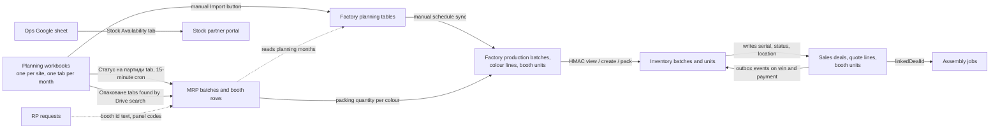

# Cross-app data review: models, batches, booths and finishes (November 2026)

Status: review and roadmap, approved by the product owner on 5 November 2026. No schema or code change is part of this document. Schema references are to `prisma/schema.prisma` on `main` at `427d5a6` (tag `v0.100.0`). Production numbers were read on 5 November 2026 through the workspace's read-only helper; the query files are listed under *Evidence*.

## Summary

- Every app writes to the same database, but booth models, production batches, physical booths and finishes each exist as several unlinked copies. Nothing joins them except text codes and one Inventory mapping table.
- Factory's `/admin/data` dropdown comes from Factory's own `FactoryBoothModel` table, not from the shared enum. MRP has its own `MrpBoothModel`. Sales and Inventory use the `BoothProductFamily` enum. Assembly uses a second enum with the same values.
- Batches are born in a Google planning workbook per site and copied into five tables that never reference each other. In production there are 94 planning batches, 36 production batches and 120 MRP batches; 39 MRP batches are unknown to Factory planning.
- A booth's 5-digit planning id survives in Factory planning and in MRP text, but Factory's production units are regenerated as 1..N on every rebuild, so Inventory receives anonymous units. Assembly shows only product names and quantities.
- Decision: one catalogue table keyed by the two-letter code, one `ProductionBatch` master owned by Inventory, `InventoryUnit` as the single booth with the planning id as its serial number, `InventoryFinish` as the finish master. Batches and booth ids are created in the Inventory app; the sheet import becomes a transition path, then stops.
- Three additive releases take the apps there. Release 1 adds the catalogue, the batch master and the identity links without changing any workflow.

## How to read this

Section 1 is the map of today. Section 2 lists every copy of each concept. Section 3 is the list of gaps with their evidence. Sections 4 and 5 are the target and the batch decision. Section 6 is the roadmap an implementation task can start from. Section 7 is what is still open. Numbers in brackets refer to query files under *Evidence*.

## 1. How the apps connect today



Who writes and who reads the shared tables that carry models, batches, booths and finishes:

| Table (schema line) | Writer | Readers | Written through |
|---|---|---|---|
| `Product`, `ProductFamilyInfo` (1134, 1207) | Sales | Sales, Assembly (product name), Inventory (via `boothFamily`) | Sales admin pages and seed |
| `QuoteLineItem` (1750) | Sales | Sales, Assembly, Inventory (quotes), Ops export | Quote editor |
| `BoothUnit` (1790) | Sales creates on win; Inventory writes `inventoryUnitId`, `serialCode`, `status`, `location`, `inventorySyncedAt` | Sales | `deals.ts:416` and `:1097`; Inventory `service.ts` write-back |
| `FactoryBoothModel`, `FactoryColor` (3298, 3355) | Factory seed | Factory, Inventory handover | `scripts/seed-baseline.ts:45-63` |
| `FactoryPlanningBatch`, `FactoryPlanningBooth` (3648, 3676) | Factory import | Factory planner, MRP month plan | `lib/planning/upsert.ts:26` |
| `FactoryProductionBatch`, `FactoryProductionBatchColor`, `FactoryProductionBoothUnit` (3381, 3407, 3422) | Factory schedule sync | Factory kiosks, Inventory handover | `lib/planning-schedule-sync.ts:237`, `lib/materialize.ts:31-34` |
| `MrpBoothModel`, `MrpBoothElement` (2675, 2689) | MRP seed and sheet sync | MRP, Factory BOM page, RP panel maps | `src/lib/sheets/sync.ts` |
| `MrpManufacturingBatch`, `MrpBatchUnit`, `MrpBatchUnitElement` (2990, 3020, 3037) | MRP sheet sync and packing ticks | MRP, Factory production sync | `sync.ts:277-287`, `opakovane.ts` |
| `InventoryBatch`, `InventoryUnit`, `InventoryFinish`, `InventoryCatalogMapping` (4938, 4992, 4957, 4972) | Inventory | Inventory; Sales through the API | `InventoryService` |
| `InventoryIntegrationEvent` (5308) | Sales and Factory enqueue, Inventory processes | Inventory worker | `worker.ts:13` |
| `Assembly` (714) | Assembly | Assembly, Gateway sheet sync | Assembly actions and sheet import |
| `rp_requests` (3898) | RP | RP, MRP deductions | RP forms |

Other facts about the connections:

- The Factory import is a button on the planner, not a schedule. The production sync is a button in Settings. The only Factory cron promotes planned batches to active at midnight (`vercel.json`).
- MRP syncs the master `Статус на партиди` tab every 15 minutes (`vercel.json` on `origin/main`) and finds each batch's `Опаковане` workbook by a Drive name search.
- Factory pins `@meavo/db` at `v0.25.0` (`apps/web/package.json:27`), MRP at `v0.73.0` (`package.json:26`). Both patch the shared schema at build time. Factory creates tables by runtime DDL that the canonical schema does not declare.
- The Stock portal reads no booth table; its numbers come from the Ops sheet.

## 2. One concept, many copies

Production counts are from 5 November 2026 [volumes, status_counts].

### 2.1 Model family

| Representation | Key | Writer | Readers | Link to the others | Values in production |
|---|---|---|---|---|---|
| `enum BoothProductFamily` (1099) | enum value | schema | Sales `Product.boothFamily`, Inventory `InventoryUnit.family`, `InventoryDemandLine.family`, `InventoryCatalogMapping.family` | none | 8 |
| `enum BoothModel` (932) | enum value | schema | Assembly `ResourceBoothModel` only | none; same 8 values as above | 8 |
| `Product` rows (1134) | cuid, free `version` | Sales | Sales, Assembly, Inventory | `boothFamily` enum | 189 booth products across 8 families, 24 products without a family [models_sales] |
| `ProductFamilyInfo` (1207) | `boothFamily` | Sales | Sales | enum | 8 families plus 14 add-on rows; names "Haven One", "Haven Two", "Haven Four", "Camden 2", "Camden 4" [models_family_info] |
| `FactoryBoothModel` (3298) | `code` SO SW C2 C4 H1 HF H2 H4 | Factory seed | Factory planner, BOM, kiosks; Inventory handover | none; Inventory maps the code with a hardcoded table (`factory.ts:13`) or a reviewed mapping | 8 [models_factory] |
| `MrpBoothModel` (2675) | `name` | MRP seed and sync | MRP, Factory BOM page (name map `lib/model-map.ts:3-18`) | none; names equal `FactoryBoothModel.nameBg` | 9 (8 families plus "Custom Batch") [models_mrp, mrp_vs_factory_model_names] |
| RP strings | `model` text | RP | RP | none | free text |
| Hardcoded lists | code | each app | each app | none | Sales `deal-values.ts:149`, Factory `model-map.ts:3`, MRP `booth-model-codes.ts:3`, Inventory `rules.ts:13`, Assembly `booth-models.ts:8` |

Display names disagree: Sales and Factory say "Haven One/Two/Four", Inventory and Assembly say "Haven 1/2/4". Factory uses `SW` for Workstation, Inventory issues `WS`.

### 2.2 Product version

| Representation | Key | Writer | Readers | Link | Values in production |
|---|---|---|---|---|---|
| `Product.version` (1134) | text | Sales | Sales | none | 2 values: empty on 736 products, "WS 1.5" on one [versions] |
| `FactoryBoothVersionCode.code` (3616) | text | Factory import from the AKS "бележка" column | Factory planner | none | 28 values; version codes like "V2.0.1" and "Haven 2/4_V1.1" mixed with notes like "Малки табелки" and "Лакиран фурнир" [versions] |
| `MrpRecipeVersion.label` (2869) | text per model | MRP | MRP, Factory packing | none | 4 labels: V1.0, V1.4, V3.4, V3.4.3 [versions] |
| `InventoryUnit.productVersion` (4992) | text | Inventory | Inventory | none | empty table |

### 2.3 Batch

| Representation | Key | Writer | Readers | Link | Count |
|---|---|---|---|---|---|
| `FactoryPlanningBatch` (3648) | `batchCode` unique, `siteId` | Factory import | Factory planner, MRP | `modelCode` → `FactoryBoothModel.code`; no FK to production | 94 (90 proposed, 4 ready) |
| `FactoryProductionBatch` (3381) | `batchCode` unique | Factory schedule sync | kiosks, Inventory handover | `boothModelId`; joined to planning by code only | 36 (4 active, 32 done); all 36 also in planning and in MRP [orphans_production_vs_planning] |
| `MrpManufacturingBatch` (2990) | `masterSheetRowKey` "AKS:AB193" unique; `name` | MRP sync | MRP, Factory production sync | `boothModelId`; `dealId` text never written (0 of 120) | 120 (107 completed, 8 in production, 5 planned); 81 in planning, 36 in production [orphans_mrp_batches] |
| `MrpProductionBatch` (3171) | cuid | MRP | MRP | none; a material consumption plan, not a batch code | separate concept |
| `InventoryBatch` (4938) | `(factoryId, batchNumber)` | Inventory | Inventory | none; `batchNumber` typed or copied from `batchCode` | 0 |
| Serial text | `serialCode` "H2 40001 AB900" | Inventory | Sales | batch embedded as text | 0 |

The 39 MRP batches missing from Factory planning are 2025 AKS batches (AB128 to AB143), satellite codes such as "AB-VB202/VB203", KAZ and VAR codes whose months were never imported [mrp_batches_not_in_planning]. Factory planning covers AKS March to November 2026, KAZ January 2025 to September 2026 and four VAR months [planning_by_month].

### 2.4 Physical booth

| Representation | Key | Writer | Readers | Link | Count |
|---|---|---|---|---|---|
| `FactoryPlanningBooth` (3676) | `boothUniqueId` unique, the 5-digit sheet id | Factory import | Factory planner; MRP month plan | planning batch FK; `colorCode` text; no FK to production units or Inventory | 1,603; ids 5515 to 13244, all distinct [numbering_planning] |
| `FactoryProductionBoothUnit` (3422) | `(batchColorId, unitIndex)` 1..N | Factory sync, regenerated on every rebuild (`lib/materialize.ts:31-34`) | kiosks (optional), Inventory handover | batch colour FK; no planning id | 624 active |
| `MrpBatchUnit` (3020) | `(manufacturingBatchId, sheetRowIndex)`; `boothIdText` | MRP sync from column D of `Опаковане` | MRP ticks, Factory production sync (colour counts) | none | 1,224; ids 11660 to 13315; 244 rows hold "TRUE" instead of an id; 944 of 980 ids exist in planning [numbering_mrp, numbering_mrp_vs_planning, mrp_units_no_id_sample] |
| `InventoryUnit` (4992) | `serialNumber` unique, `serialCode` unique, `(sourceSystem, sourceId)` | Inventory | Inventory, Sales (write-back) | FKs to batch, factory, finish, warehouse; no FK to any Factory, MRP or Sales row | 0 |
| `BoothUnit` (1790) | cuid; `dealId` → `Deal.dealId` | Sales on win; Inventory write-back | Sales | `inventoryUnitId` unique text without FK | 9,132 (9,129 PLANNED, 3 IN_STORAGE), all rows created in 2026 [boothunit_by_year] |
| `rp_requests.booth_id` (3898) | text | RP | RP | none | 366 of 379 requests have a booth id; 157 are 5-digit; 77 of those exist in planning [rp_booth_ids] |
| `Assembly` (714) | `linkedDealId` → `Deal.dealId` | Assembly | Assembly | no booth identity; `visitBooths` JSON is name and quantity | 1,998 assemblies, 161 linked to a deal, 30 with visit booths [assembly_booths] |

The planning id and the Inventory serial share one format: Factory prints `SW 13162 AB193` (`lib/model-map.ts` `formatBoothId`), Inventory prints `H2 40001 AB900` (`rules.ts:97-104`). Inventory accepts numbers below 40000 as legacy identities (`rules.ts:268-306`) and issues new numbers from 40000. No planning id collides with an issued serial today because Inventory holds no units [numbering_collisions].

### 2.5 Finish and colour

| Representation | Key | Writer | Readers | Link | Values in production |
|---|---|---|---|---|---|
| `enum ProductFinish` (1070) plus free `finishDetails` | enum | Sales | Sales, Inventory | none | quote lines: WHITE_STOCK 7,508 (20 detail texts), CUSTOM 2,423 (72), BLACK_STOCK 1,303 (13), TBC 1,067 (63), LDF_COLOUR 15 (5) [sales_finish_details] |
| `BoothUnit.finish` | enum | Sales | Sales | none | CUSTOM 4,196, WHITE_STOCK 2,958, BLACK_STOCK 1,971, LDF_COLOUR 7 [colours] |
| `FactoryColor` (3355) | `code` | Factory seed | kiosks, scrap reports, Inventory handover | none | 7 codes: WHITE, BLACK, OAK, SANDY_YELLOW, ANTIQUE_ROSE, STONE_GREEN, INDIGO_BLUE [colours] |
| `FactoryPlanningBooth.colorCode` | text | Factory import | planner | no FK to `FactoryColor`; 1 of 109 spellings matches a code | 109 spellings: "Pure White" 793, "Pure Black" 511, "Oak Veneer" 72, then RAL and Egger codes [planning_colour_vs_factory] |
| `MrpBatchUnit.colour` | text | MRP sync | MRP, Factory sync via `mapColorToFactory` (`lib/planning/factory-sync.ts:16`, duplicated in `lib/packing/panel-map.ts:64`) | none | 11 spellings: "Pure White" 757, "Pure Black" 377, "Oak Veneer" 69 [colours] |
| `MrpElementBomLine.colour` | text or null (all colours) | MRP | MRP | none | 4 values [colours] |
| `InventoryFinish` (4957) | `code` | Inventory | Inventory | the only bridge: `InventoryCatalogMapping(sourceSystem, sourceKind = finish, sourceId) → finishId` | 0 rows in production |
| RP `color` | text | RP | RP | none | free text |

### 2.6 Site

| Representation | Values in production | Writer | Link |
|---|---|---|---|
| `FactorySite` (3604) | AKS Аксаково, KAZ Казанлък, VAR Варна, with the planning spreadsheet id per site | Factory seed | none |
| `MrpWarehouse` (2661) | aksakovo, kazanlak, varna, top (Тополи), WH1, WH2 | MRP | none |
| `InventoryFactory` (4922) | none yet | Inventory settings | none |
| `InventoryWarehouse` (4845) | TOP "Topoli" (CENTRAL) | Inventory settings | none |

[sites]

### 2.7 Market and electrics

| Representation | Shape | Writer |
|---|---|---|
| `Deal.market`, `Deal.socketType` (1406) | text | Sales; `MARKET_OPTIONS` and `SOCKET_TYPE_OPTIONS` hardcoded in `deal-values.ts` |
| `InventoryUnit.voltage`, `socketType` (4992) | enum `InventoryVoltage` plus text; UK mapped to GB in `source-keys.ts` | Inventory |
| Factory `isUsMarket`, `usBooths`, `isUs` (3648, 3407, 3422) | booleans | Factory import and sync |
| MRP `market` | text, null or US | MRP |
| `InventoryCatalogMapping` market → country | reviewed rows | Inventory |

### 2.8 Panel

| Representation | Key | Link |
|---|---|---|
| `FactoryElement.code` (3315) | text unique | string equality only |
| `MrpBoothElement.code` (2689) | text, written by a meavo-db script, never by MRP | string equality with `FactoryElement.code`; Factory maps MRP labels with `lib/packing/panel-map.ts:6-62` |
| `RpLineItem.panelCode`, `RpPanelMrpMap.panelCode` (3957, 4008) | text | the only FK is `RpPanelMrpMap.boothElementId` → `MrpBoothElement` |

## 3. Gaps that matter

| # | Gap | Evidence |
|---|---|---|
| G1 | No foreign key joins any two of the five batch tables; MRP and Factory meet only by batch code text, and 39 of 120 MRP batches have no planning row | [orphans_mrp_batches], [mrp_batches_not_in_planning] |
| G2 | The booth id from the sheet is lost before handover: `materializeBoothUnits` deletes and recreates production units as 1..N, so Inventory stores `factory:["AB193","WHITE",3]` as the unit key | `lib/materialize.ts:31-34`, `factory.ts:60` |
| G3 | Assembly cannot show a booth, its serial or its material; it reads only `Deal.lineItems` product names | Assembly `src/lib/booth-summary.ts:6`, `src/lib/deal-queries.ts:6`; 161 of 1,998 assemblies are linked to a deal |
| G4 | MRP's booth rows carry "TRUE" instead of an id in 244 of 1,224 cases, and 36 ids are unknown to planning | [mrp_units_no_id_sample], [numbering_mrp_vs_planning] |
| G5 | 1,390 of 1,603 planning booths have no model code. The import log holds no "unknown model" error (7,242 of the 7,243 logged errors are "missing booth_unique_id"), so the model is simply not captured on the path that created most rows; `parsers.ts` has two row parsers and only the first maps a `model` column. Confirm the cause before the catalogue backfill | [planning_model_codes], [import_run_errors], `lib/planning/import/parsers.ts:36` and `:104-108` |
| G6 | Colours are free text in planning (109 spellings) and MRP (11), and only 7 Factory codes exist; Sales keeps finishes as 4 enum buckets plus detail text | [planning_colour_vs_factory], [colours], [sales_finish_details] |
| G7 | Versions live in four unrelated places and the Factory list mixes version codes with free notes | [versions] |
| G8 | Factory and MRP build against schemas 75 and 27 tags behind, patch them at build time, and Factory creates tables by runtime DDL that the canonical schema does not declare | `apps/web/package.json:27`, MRP `package.json:26`, `scripts/patch-schemas.cjs` in both |
| G9 | MRP runs SQL writers inside `next build` (`apply-recipe-version-*`, `apply-electric-*`, `backfill-electric-snapshots`, `cleanup-recipe-versions`), which is a production write outside a release | MRP `package.json` scripts on `origin/main` |
| G10 | Sites exist four times with different codes (`AKS` vs `aksakovo`, `top` vs `TOP`) | [sites] |
| G11 | `BoothUnit.inventoryUnitId` has no foreign key; today 0 of 9,132 rows are linked, so a constraint can still be added without a backfill | [orphans_boothunit] |
| G12 | RP stores the requesting user's e-mail in `user_id` (379 of 379 rows, 11 distinct values) and a free booth id, 77 of which match planning | [rp_user_id_format], [rp_booth_ids] |
| G13 | The Factory import writes one `FactoryPlanningImportRun` row per run: 122,894 rows (25 MB) between 14 August and 28 October 2026, about 1,650 a day, the largest table by rows; the GET schedule-sync route imports 12 months for every site on each call | [import_runs], [rowcounts_m_z], `lib/planning/import-month-tab.ts:156` |

## 4. Target model

Decided on 5 November 2026. Every change is additive; existing columns keep working until the retirement release.

### 4.1 Booth catalogue

One table keyed by the two-letter code. `BoothProductFamily` stays the enum key in the columns that already use it (Sales, Inventory), so no column migrates to an id; the table adds the metadata and the links Factory and MRP need. Owner: inventory; read by every app.

```prisma
model BoothFamily {
  code          String             @id            // SO WS C2 C4 H1 HF H2 H4 (serial prefix)
  family        BoothProductFamily @unique
  name          String                            // Soho, Workstation, Camden 2, Camden 4, Haven One, Haven Focus, Haven Two, Haven Four
  nameBg        String
  line          String                            // Classic | Haven
  factoryCode   String             @unique        // FactoryBoothModel.code; SW for Workstation
  mrpName       String             @unique        // MrpBoothModel.name
  aliases       String[]           @default([])   // "camden 7", "have four", "meavo two", ...
  sortOrder     Int                @default(0)
  isActive      Boolean            @default(true)
  createdAt     DateTime           @default(now())
  updatedAt     DateTime           @updatedAt
}
```

Attachments, all nullable and backfilled by SQL:

```text
FactoryBoothModel.familyCode   String? @unique  -> BoothFamily.code   backfill: by factoryCode
MrpBoothModel.familyCode       String? @unique  -> BoothFamily.code   backfill: lower(name) = lower(mrpName) or an alias; "Custom Batch" stays null
ProductFamilyInfo.displayName                                          backfill: BoothFamily.name
ResourceBoothModel.family      BoothProductFamily?                     backfill: boothModel::text; enum BoothModel dropped in release 3
```

Versions follow in release 2 as `BoothFamilyVersion(familyCode, code, description, isActive, isDefault)` once the audit has separated the real version codes from the notes in `FactoryBoothVersionCode`.

Hardcoded lists that go away once each app reads the table: Sales `BOOTH_FAMILY_LABELS` (`deal-values.ts:149`) and the seed names; Factory `MODEL_BY_NAME` and `modelCodeToName` (`lib/model-map.ts:3-40`), `BOOTH_MODELS` in `scripts/seed-baseline.ts:45`; MRP `booth-model-codes.ts` and the create-by-name branch of the sheet sync; Inventory `FAMILY` (`factory.ts:13`), `SERIAL_PREFIX` (`rules.ts:13`) and the labels in `src/lib/format.ts`; Assembly `BOOTH_MODEL_GROUPS` (`booth-models.ts:8`); Stock `view-recipes.ts`. The Factory `/admin/data` page keeps `prisma.factoryBoothModel.findMany` (`lib/planning/ensure-model-panel-effort.ts:73`) and shows `BoothFamily.nameBg`.

### 4.2 Batch master and sites

```prisma
model ProductionBatch {
  id               String                @id @default(cuid())
  code             String                @unique      // AB193, VB202, KB134
  siteId           String                             // FactorySite
  familyCode       String?                            // BoothFamily
  versionCode      String?
  productionYear   Int?
  productionMonth  Int?
  plannedQty       Int?
  plannedStart     DateTime?
  plannedEnd       DateTime?
  originalDeadline DateTime?
  isUsMarket       Boolean?
  status           ProductionBatchStatus              // proposed | planned | in_production | partially_ready | ready | cancelled
  sourceSystem     String?                            // sheet | inventory
  sourceId         String?                            // AKS:AB193
  createdById      String?
  createdAt        DateTime              @default(now())
  updatedAt        DateTime              @updatedAt
  @@unique([sourceSystem, sourceId])
  @@index([siteId, productionYear, productionMonth])
  @@index([status])
}
```

`FactorySite` becomes the site master because it already has the three sites and the spreadsheet id per site. Topoli is a warehouse, not a factory, and stays an `InventoryWarehouse`.

```text
FactoryPlanningBatch.productionBatchId    String? @unique  -> ProductionBatch   backfill by batchCode
FactoryProductionBatch.productionBatchId  String? @unique  -> ProductionBatch   backfill by batchCode
MrpManufacturingBatch.productionBatchId   String? @unique  -> ProductionBatch   backfill by name, site from the row key prefix
InventoryBatch.productionBatchId          String? @unique  -> ProductionBatch   backfill by batchNumber
MrpWarehouse.siteId                       String?          -> FactorySite       backfill aksakovo->AKS, varna->VAR, kazanlak->KAZ
InventoryFactory.siteId                   String?          -> FactorySite       backfill by code once rows exist
```

Master rows are seeded in this order: planning batches (they carry site, month, deadline), then production-only codes, then MRP names that are not satellite codes, then Inventory batch numbers. `MrpProductionBatch` is a material plan and is only renamed later.

### 4.3 Booth identity

`InventoryUnit` is the single physical booth. It already owns the serial sequence, the register, the `BoothUnitStatus` lifecycle including `PLANNED`, and the Sales write-back.

Numbering rule:

- `serialNumber` is the permanent booth number and equals the 5-digit planning id for every sheet-born booth (today 5515 to 13244, all distinct).
- App-born booths continue the same series. The next value is set from the highest id across planning, MRP and the sheet's `Stock Booths` tab; the 40000 start and the "below 40000 is legacy" rule in `rules.ts:268-306` are replaced by "any 5-digit number not yet used".
- `serialCode` keeps the format `<prefix> <number> <batch>`. Workstation uses `WS`; sheet rows that say `SW` are relabelled on import and the review accepts that older physical labels read `SW`.

Units are created at planning time:

```text
InventoryUnit.productionBatchId  String?  -> ProductionBatch
InventoryUnit.plannedSortOrder   Int?
status = PLANNED, expectedReadyAt = batch.plannedEnd, voltage from the US flag,
productVersion = version code, finishId from the reviewed mapping or an unreviewed
InventoryFinish('sheet:<colour text>') that Ops review in Settings
```

Links from the other copies, all nullable, unique where one-to-one:

```text
FactoryPlanningBooth.inventoryUnitId        String? @unique   backfill: serialNumber = boothUniqueId::int
FactoryProductionBoothUnit.inventoryUnitId  String? @unique   set by the stable materialise step
MrpBatchUnit.inventoryUnitId                String? @unique   backfill: 5-digit id parsed from boothIdText within the same batch
rp_requests.inventory_unit_id               String?           backfill: 5-digit id parsed from booth_id
BoothUnit.inventoryUnitId                   real FK, ON DELETE SET NULL (0 rows linked today)
```

Behaviour changes that make the links hold:

- `materializeBoothUnits` (`lib/materialize.ts:23-43`) upserts by `(batchColorId, unitIndex)`, deletes only surplus rows without events, and sets `inventoryUnitId` from the master booths of that batch and colour in `plannedSortOrder`.
- The Inventory handover (`factory.ts`) resolves a unit by `inventoryUnitId` first and by the legacy `factoryUnitKey` (`source-keys.ts:15`) second; `create` becomes "link and set IN_PRODUCTION" for a PLANNED unit; `pack` accepts either key.
- Assembly reads `Assembly.linkedDealId → Deal → BoothUnit[] → InventoryUnit → InventoryFinish` and shows "WS 13162 AB193 · Pure White · V3.4", with the quantity summary as the fallback. Material detail comes from the finish in release 2 and from the MRP recipe through the batch in release 3.

### 4.4 Finish master

`InventoryFinish` stays and gains the columns the other apps need; aliases stay in `InventoryCatalogMapping`, which already has the review workflow.

```text
InventoryFinish.nameBg            String?
InventoryFinish.salesFinish       ProductFinish?           // the Sales bucket this exact finish belongs to
InventoryFinish.factoryColorCode  String? @unique -> FactoryColor.code
InventoryFinish.materialKind      String?                  // LDF | veneer | RAL | fabric
InventoryFinish.ralCode           String?
InventoryCatalogMapping.sourceSystem gains: sheet | mrp | rp
FactoryPlanningBooth.finishId     String? -> InventoryFinish   resolved at import through the mapping
MrpBatchUnit.finishId             String? -> InventoryFinish   resolved at sync through the mapping
```

The two copies of `mapColorToFactory` are replaced by `sheet` mapping rows. Free text stays free: Sales `finishDetails`, MRP BOM colour until its recipe screen adopts the master, RP `color` until RP bumps, and the raw sheet cell, kept in `InventoryUnit.metadata`.

### 4.5 Pins and build-time DDL

- Factory's runtime tables and columns move into meavo-db as `scripts/add-factory-floor-tables.sql`, declared as production actually has them. The production tables are `FactoryWorker`, `FactoryStationAssignment`, `FactoryPallet`, `FactoryPalletLine`, `FactoryPalletHold`, `FactoryModelPanelEffort`, `FactoryStationBreak`, `FactoryPanelOrder`, `FactoryPanelOrderEvent`, `FactoryPanelOrderScrapReport`, plus columns on `FactoryStationElementRequirement`, `FactoryProductionBatch` and `FactoryProductionEvent`. Run `apply-sql.sh … --diff-only` against the draft first.
- Factory then pins the tag, deletes `scripts/patch-schemas.cjs` and the `patch-factory-*.cjs` files from `build` and `postinstall`, removes the `ensure*Schema()` modules, and aligns Prisma 6.19.
- MRP pins the tag, removes `patch-schemas.cjs` and the build-time SQL writers from `build`, confirms with `--diff-only` that `v0.100.0` already has what they add, and turns the two data scripts into admin actions. Note that `MrpElectricAssemblyVersion` is declared in the schema but absent from production; the audit lists it.
- Sales and Inventory bump the pin only. Assembly bumps in release 1 because it reads the catalogue.

## 5. Where batches are created

| Option | Aksakovo planner | MRP (batch × colour × booth × panel ticks) | Factory kiosks | Inventory handover |
|---|---|---|---|---|
| A. Inventory "Production plan" screen (chosen) | New screen; the monthly credits view stays in Factory and reads the master; the `(Webapp)` tab is still written for continuity | `MrpManufacturingBatch` and `MrpBatchUnit` are seeded from the master; ticks stay on the `Опаковане` tab until release 3 | unchanged, `FactoryProductionBatch` is synced from the master | trivial: units exist at planning, handover is a status change |
| B. Factory planner creates | best fit for the current UI, parsers and credits; `POST /api/admin/schedule` exists without a form | as A | same code base | Factory would have to issue booth numbers through Inventory's API, which crosses ownership |
| C. Sheet stays the entry point, import writes the master | zero change | unchanged | unchanged | still "handover creates the row" unless the import creates PLANNED units |

Why A: Inventory owns the serial sequence, the transaction and idempotency layer (`InventoryService.once`, `service.ts:365`), the Factory-facing API and the test suites. Option B cannot start before Factory is off `v0.25.0`. Option C keeps the workbook as the source of truth, which is the problem being solved.

Transition:

1. Release 1: the Factory import keeps writing `FactoryPlanningBatch` and `FactoryPlanningBooth` and additionally enqueues one `InventoryIntegrationEvent` per batch (`sourceSystem = factory`, `action = plan.upsert`, `sourceEventId = plan:AKS:AB193:<importRunId>`) from `lib/planning/upsert.ts`; `promotePlannedBatchesFromStatusTab` (`lib/planning-schedule-sync.ts:167`) enqueues `plan.status`. The Inventory worker (`worker.ts:13`) turns them into `ProductionBatch` rows and PLANNED units through new `planBatch` and `planBooths` service methods. MRP sync (`sync.ts:277`) sets `productionBatchId` by code.
2. Release 2: the Inventory screen creates batches and units up front; Inventory writes the sheet's `(Webapp)` tab with a port of `lib/planning/sheet-export.ts` `buildExportMatrix` (`:121`) and `webappTabName` (`factories-config.ts:171`); the Factory import switches to reconcile-only and reports differences; MRP seeds `MrpManufacturingBatch` with `masterSheetRowKey = sourceId` and `MrpBatchUnit` rows keyed by booth id, so `opakovane.ts` matches rows by id instead of row index.
3. Release 3: the sheet import stops for new months; the `(Webapp)` export stops when MRP takes its panel ticks from Factory kiosk events, which already carry `elementId`, `colorId` and the unit id.

## 6. Roadmap

Each release is one meavo-db PR into `staging` with its SQL scripts, consumer PRs pinned to the staging commit for validation, one human yes for the bundle, a tag, `scripts/apply-sql.sh production` for each script twice, then consumer re-pins and merges. All scripts are additive and idempotent.

### Release 1: Foundations (additive only)

| Repository | PR purpose | Changes |
|---|---|---|
| meavo-db | `feat/booth-catalogue-batch-master` | `BoothFamily`, `ProductionBatch`, `ProductionBatchStatus`, the link columns of 4.1 to 4.3, the Factory floor tables of 4.5; scripts `add-booth-family-catalog.sql`, `add-production-batch-master.sql`, `add-booth-identity-links.sql`, `add-factory-floor-tables.sql`; README, `docs/data-model.md`, `docs/inventory-v1.md` |
| Meavo-Factory | pin bump and `plan.*` events | pin `@meavo/db`, delete the build-time patches and `ensure*Schema()` files, enqueue `plan.upsert` and `plan.status` from the import, stable `materializeBoothUnits`, catalogue labels on `/admin/data` |
| meavo-mrp | pin bump and links | pin `@meavo/db`, remove build-time SQL, resolve models through `BoothFamily.mrpName` and aliases with create-only-when-unmatched, set `productionBatchId` in `sync.ts` |
| meavo-inventory | catalogue, worker, handover | read `BoothFamily` in `getCatalog`, worker handlers `plan.upsert` and `plan.status`, `planBatch` and `planBooths` using `issueSerial` (`service.ts:1959`) with the new numbering rule, handover by `inventoryUnitId` with `factoryUnitKey` fallback, an "Adopt planning booths" admin action, `verify-postgres.mjs` flags for the four scripts |
| sales | labels | `BOOTH_FAMILY_LABELS` and seed names from `BoothFamily`; pin bump |
| meavo-assembly | booth display | `ResourceBoothModel.family`, booth id and serial on the assembly page from `BoothUnit` and `InventoryUnit`; pin bump |

Production steps: tag `v0.101.0`; apply the four scripts in that order; re-pin and release the five consumers. Verification: Inventory `npm test` on PGlite for `planBatch`, `planBooths`, adoption and stable handover; `scripts/verify-postgres.mjs` replaying each script twice; staging end-to-end: import AKS January 2026, then `ProductionBatch` count equals the batches on `Статус на партиди`, PLANNED units equal the sheet's booths, no duplicate `serialNumber`, MRP links every non-satellite batch, one handover keeps `FactoryProductionBoothUnit` ids across `materializeWorkItems`. After the production release: 8 `BoothFamily` rows, no null `FactoryBoothModel.familyCode`, the list of unlinked `MrpBoothModel` names, `ProductionBatch` count at least the planning batch count, orphan queries at zero, `InventorySerialSequence` unchanged, kiosks and the MRP cron healthy.

### Release 2: Create in the app

| Repository | Changes |
|---|---|
| meavo-db | `add-finish-master.sql` (4.4), `BoothFamilyVersion`, `rp_requests.inventory_unit_id` |
| meavo-inventory | Production plan screen under `src/app/(inventory)/plan/` (month per site, next code, family, version, deadline, booth rows with colour, US flag, version, notes, reorder), `(Webapp)` tab export, finish master columns in Settings |
| Meavo-Factory | import in reconcile mode; `mapColorToFactory` replaced by mapping rows; `FactoryPlanningBooth.finishId` |
| meavo-mrp | `ensureManufacturingBatchesFromMaster()`, `MrpBatchUnit.finishId` and `inventoryUnitId`, `opakovane.ts` matching by booth id |
| meavo-assembly | finish and material on the assembly page |
| meavo-stock, meavo-rp, meavo-gateway | catalogue reads; RP `inventory_unit_id` |

Verification: a batch created in Inventory appears in the Factory planner and in MRP within one sync; the `(Webapp)` tab matches the app; colour resolution reports the unresolved spellings.

### Release 3: Retire

- Sheet import off for new months; `FactoryPlanningBatch` and `FactoryPlanningBooth` read from the master, then dropped.
- `InventoryBatch` replaced by `InventoryUnit.productionBatchId`.
- `enum BoothModel` and the family mapping rows removed; `mapColorToFactory` deleted.
- MRP panel ticks from Factory kiosk events; the `(Webapp)` export stops.
- The audit's "needs app changes" items scheduled.

## 7. Decisions still open

- [ ] Next serial number: set from the highest id across planning (13244), MRP (13315) and the `Stock Booths` tab, checked by the audit; decide whether cancelled booths keep their number.
- [ ] Batch status vocabulary for `ProductionBatchStatus`: the sheet's words or Factory's (`planned`, `active`, `paused`, `done`).
- [ ] Keep writing the `(Webapp)` tab after cut-over until MRP leaves the `Опаковане` tab, or stop earlier.
- [ ] Assembly material source: finish details in release 2, full MRP recipe in release 3, or both.
- [ ] Factory floor tables into meavo-db (recommended) or kept local with the runtime DDL.
- [ ] Keep the name `InventoryFinish` or rename to `Finish` with `@@map`.
- [ ] What to do with the 244 MRP rows that hold "TRUE" and the 36 ids unknown to planning before backfilling links.
- [ ] Whether `Product.version` is retired in favour of `BoothFamilyVersion` or kept as free text.

## Evidence

Code traces, all read-only, 5 November 2026: the canonical schema map (meavo-db `origin/main` 427d5a6), the Factory and MRP data-source trace (Factory worktree at e22b3ee, MRP `origin/main` 1c96697), the Sales, Assembly, Inventory and Stock trace (Sales worktree at 1e45257, Assembly `origin/main` 2f630de, Inventory `b8144f3`, Stock `origin/main` 2a6f356).

Production queries (read-only helper, 5 November 2026), saved as `output/cross-app-review-2026-11/queries/<name>.sql` and `.json`: `volumes`, `status_counts`, `numbering_planning`, `numbering_mrp`, `numbering_inventory`, `numbering_collisions`, `numbering_mrp_vs_planning`, `serial_sequence`, `versions`, `models_factory`, `models_mrp`, `models_sales`, `models_family_info`, `mrp_vs_factory_model_names`, `colours`, `planning_colour_vs_factory`, `sales_finish_details`, `sites`, `orphans_boothunit`, `orphans_inventory_factory_keys`, `orphans_mrp_batches`, `orphans_production_vs_planning`, `inventory_batches`, `mrp_batches_not_in_planning`, `mrp_units_no_id_sample`, `planning_by_month`, `planning_model_codes`, `rp_booth_ids`, `rp_user_id_format`, `boothunit_by_year`, `assembly_booths`, `people`, `contacts`, `labels`, `tables_a_l`, `tables_m_z`, `unused_indexes`, `rowcounts_a_l`, `rowcounts_m_z`, `schemas`, `tables_non_public`, `db_size`, `stats_reset`, `import_runs`, `import_run_errors`. Row counts are `count(*)` values; the `pg_stat` counters reset whenever the Neon compute restarts, so insert, update and index-scan figures only cover the time since the last restart.

The planning workbook for Aksakovo is `1aly6kRe_01ZDH_MnzaTtH6uVrqdsUX_p8AUAvt8EdO4` ("Аксаково планиране | партиди | производство | за склад"), with month tabs `March25` to `Oct25` and `January` to `December`, plus `Статус на партиди`, `Stock Booths`, `Опаковане`, `Прогрес` and `Booth Analytics`.
